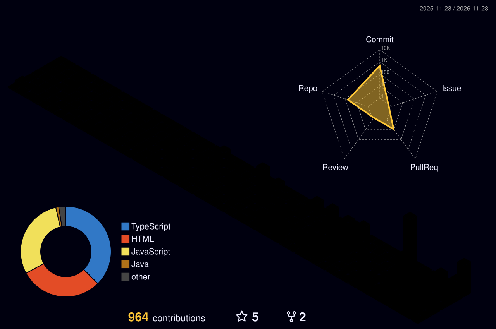

  

  
  
  
  

  

## About me

I'm a Computer Science student at the University of Ghana with a focus on digital forensics: how evidence is found, preserved, and pieced back together from digital systems. Alongside that, I build for the web and mobile in React and React Native, and lately I've been working in 3D with Three.js. My encrypted chat app, UsTwo, is where the two interests meet.

## What I'm building

<table>
  <tr>
    <td width="33%" valign="top">
      <h3><a href="https://github.com/Maxorleans55/e2ee-couple-app">UsTwo</a></h3>
      An end-to-end encrypted chat app for couples.  
      React Native, Expo
    </td>
    <td width="33%" valign="top">
      <h3><a href="https://github.com/Maxorleans55/christmas-tree-gallery">Christmas Tree Gallery</a></h3>
      A 3D Christmas tree decorated with your own photos and videos.  
      React, Three.js
    </td>
    <td width="33%" valign="top">
      <h3><a href="https://github.com/Maxorleans55/multi-bot">Multi Bot</a></h3>
      One bot that handles several jobs from a single place.  
      JavaScript, Node.js
    </td>
  </tr>
</table>

## Tools I use

  

  
  
  

## My year in 3D

  

  

  

